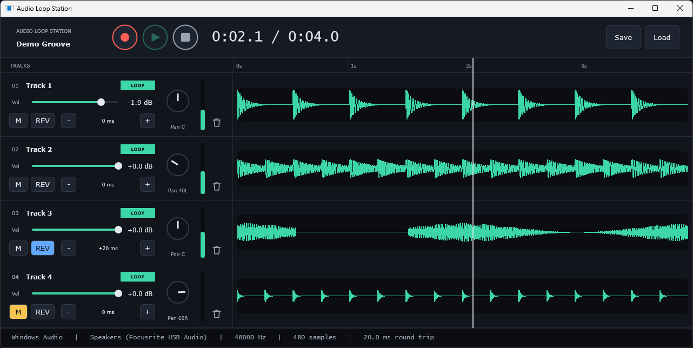

# Audio Loop Station

A desktop looper for Windows that layers up to four mono tracks over a shared loop.

Team: Elliot Hwang, Hunter Shipman, Robert Thom.

## Quick start

Windows 10 or 11 (64-bit) only. You need a microphone, and headphones are recommended.

1. Download `AudioLoopStation.exe` from the
   [latest release](https://github.com/elliothwang/audio-loop-station/releases/latest).
2. Run it. If Windows shows **Windows protected your PC**, click **More info**, then **Run anyway**.
3. Press **Record**, play something, and press **Record** again. Your loop starts playing.

Nothing else needs to be installed. If the app can't find your microphone, see
[Install and run](docs/install.md).

## Documentation

- [Install and run](docs/install.md): download, first launch, audio setup, and troubleshooting
- [User guide](docs/user-guide.md): a step-by-step tour, every control, limits, and where loops are
  saved
- [Development](docs/development.md): building from source, tests, CI, code layout, and releasing
