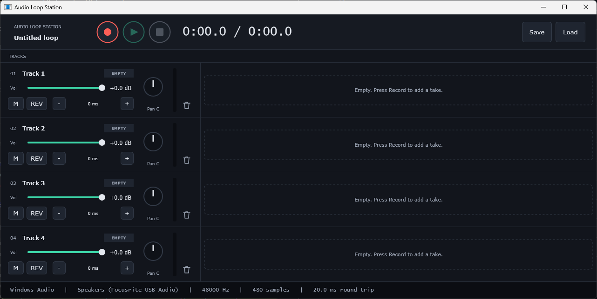
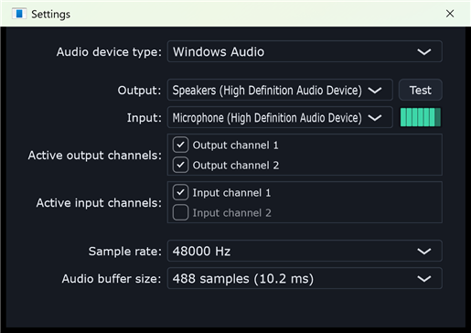

# Install and run

Audio Loop Station runs on **Windows 10 or 11 (64-bit) only**. It is a single `.exe` with nothing to
install: the C++ runtime is built into it, so you don't need the Visual C++ Redistributable.

## What you need

- A Windows 10 or 11 (64-bit) computer
- A microphone (a built-in laptop mic works)
- Headphones, so the speakers don't bleed into the microphone while you record over a loop

## 1. Download

1. Open the [latest release](https://github.com/elliothwang/audio-loop-station/releases/latest).
2. Under **Assets**, download `AudioLoopStation.exe`.
3. If your browser warns that the file isn't commonly downloaded, choose **Keep**.

## 2. Run it

1. Double-click `AudioLoopStation.exe`.
2. The exe isn't signed, so Windows may show **Windows protected your PC**. Click **More info**, then
   **Run anyway**. Windows only asks the first time.

The window opens with four empty tracks:

## 3. Check the audio device

The app starts with your Windows default microphone and speakers. The bar along the bottom shows the
device it opened, its sample rate, its buffer size, and the round-trip latency:

To use a different microphone, input, or speakers, press **Settings** (the gear at the top right).
It's only available while every track is empty.

- **Output** and **Input** pick the devices. **Test** plays a short tone through the output.
- The meter beside **Input** moves when the input hears something.
- **Active input channels** picks which input records. Only one can be on, so untick the current one
  before ticking another. If a take is only hiss or noise, try the other channel.
- **Sample rate** has to match the rate a saved loop was recorded at for it to load.

The app doesn't remember these choices, so check them each time you start it.

If the footer says **No audio device**, or the **Input** meter never moves:

1. **Allow microphone access.** Open Windows **Settings > Privacy & security > Microphone**, and turn
   on both **Microphone access** and **Let desktop apps access your microphone**.
2. **Restart the app**, then open **Settings** and pick your devices again.

## Uninstall

Delete `AudioLoopStation.exe`. Saved loops are kept in `Documents\Audio Loop Station\Loops`; delete
that folder too if you don't want them.

## Troubleshooting

| Problem | Fix |
|---|---|
| "No audio device" in the footer, or **Record failed** with "No audio device is running." | Follow step 3 above. |
| Recording is silent | In **Settings**, check the **Input** device and that its meter moves (step 3). |
| A take is only hiss or noise | The wrong input channel is on. In **Settings**, untick it under **Active input channels** and tick the other one. |
| **Settings** is greyed out | It's only available while every track is empty. Delete each track's take first. |
| You hear yourself or the loop twice in a new take | Use headphones, so the speakers don't reach the microphone. |
| **Load failed** with "This loop was saved at … Hz, but the audio device runs at … Hz." | Loops only load at the sample rate they were saved at. With every track empty, open **Settings**, set **Sample rate** to the loop's rate, and load it again. |
| Windows won't run the exe at all | Some managed computers block unsigned downloads. Try a computer you control. |

Next, see the [user guide](user-guide.md) for a step-by-step tour.
