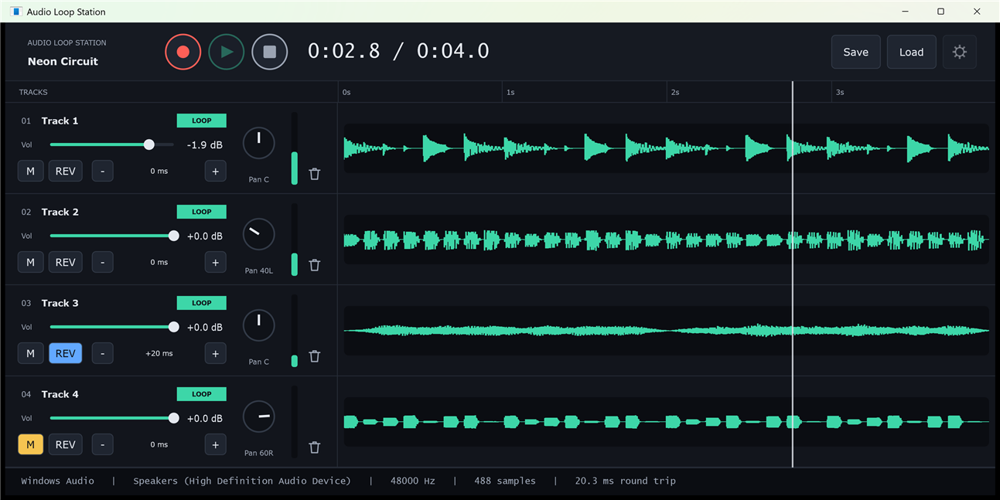
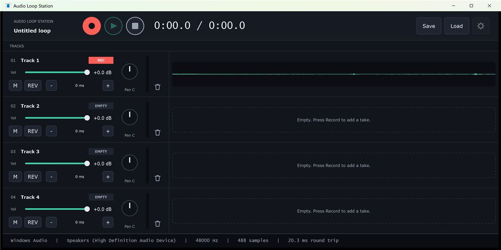
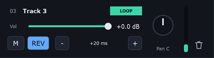
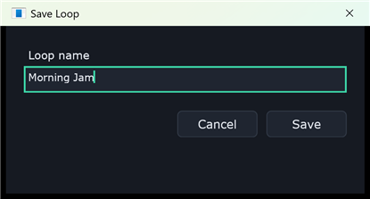
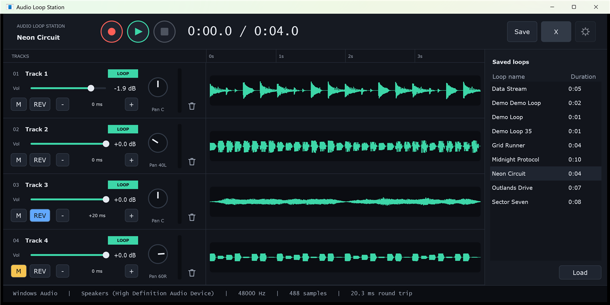

# User guide

Audio Loop Station records up to four mono tracks that loop together. The first take you record sets
the loop's length, and every later take lines up with it. If you haven't installed it yet, start with
[Install and run](install.md).

## Tour

### 1. Record the first take

1. Press **Record** (the red circle). Track 1 shows **REC** and starts recording.
2. Play or sing something short, like a rhythm or a chord pattern.
3. Press **Record** again to finish. The take becomes the loop and starts playing right away.

To finish without playing, press **Stop** instead, then **Play** when you're ready. A first take
stops on its own at 60 seconds.

The timer stays at 0:00.0 while the first take records, because the loop's length isn't known until
it finishes. The track's waveform draws as you record, so you can see the take coming in.

### 2. Record over the loop

1. While the loop plays, press **Record**. The lowest-numbered empty track starts recording.
2. Play along. The take records for exactly one loop, then joins the loop on its own. Press
   **Record** again to end it early.

Each take plays back from the point in the loop where you started it. If the loop is stopped,
**Record** restarts it from the top and records at the same time.

When all four tracks have audio, **Record** does nothing. Delete a track to make room.

### 3. Play and stop

- **Play** starts the loop from the top.
- **Stop** stops it. If a take is recording, Stop keeps what was recorded so far.

### 4. Mix each track

Every track has its own controls. Changes fade in over a few milliseconds, so they don't click.

| Control | What it does |
|---|---|
| **Vol** slider | Sets the track's volume. The readout is in dB, from +0.0 dB at full volume down to silence. |
| **Pan** knob | Moves the track between the left and right speakers. Drag up, down, left, or right, and double-click to centre it. The label reads C for centre, or how far left (L) or right (R). |
| **M** | Mutes the track. The button turns yellow while muted. |
| **REV** | Plays the take backwards. Its waveform flips to match. |
| **−** and **+** | Slip the take 10 ms earlier or later per press, to line up a take that landed late. The readout shows the total offset. |
| Meter | Shows the track's level after its volume and before pan. |
| Trash can | Deletes the track's take. |

### 5. Delete a track

Press a track's trash can. The other tracks keep playing, and the empty track is the next one
**Record** fills. Its REV and slip settings reset. You can't delete while a take is recording.

Deleting the last track with audio clears the loop, so the next take sets a new length.

### 6. Save the loop

1. Press **Save**.
2. Type a name and press **Save**.

The loop's name appears in the top left, and a message shows where it was saved. Each name can only
be used once. Finish recording before you save.

Saving keeps each track's audio and where its take starts in the loop. It doesn't keep the mixer
settings (volume, pan, mute, reverse, slip); those reset when you load.

### 7. Load a saved loop

1. Press **Load**. The saved loops panel opens beside the tracks, and the button turns into **X**.
2. Pick a loop and press **Load**, or double-click it.
3. Press **Play**.

Loading replaces all four tracks and leaves the loop stopped. Press **X** to close the panel without
loading. A loop only loads if your audio device runs at the sample rate it was saved at.

### 8. Change the audio device

Press **Settings** (the gear) to pick the output, the input and which input channel records, the
sample rate, and the buffer size. It's only available while every track is empty, since a new sample
rate would clear them. See [Install and run](install.md#3-check-the-audio-device) for each setting.

## Limits

- Four tracks, each one mono.
- A loop is at most 60 seconds long.
- Saved loops only load at the sample rate they were saved at.
- Audio device settings aren't remembered between launches.
- There's no undo. Deleting a track or loading a loop replaces what was there.

## Where loops are saved

Each saved loop is a folder in `Documents\Audio Loop Station\Loops`, named after the loop:

| File | Contents |
|---|---|
| `loop.json` | The sample rate, the loop's length, and where each track's take starts |
| `track1.wav` … `track4.wav` | Each track's audio as a mono 32-bit float WAV. Empty tracks have no file. |

The WAV files open in any audio editor. To delete a saved loop, delete its folder.
